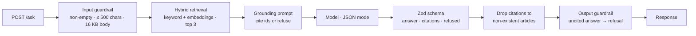

# AI Customer Support Agent

**A TypeScript support agent that answers only from a knowledge base: hybrid keyword + embedding retrieval, a prompt that requires citations or an explicit refusal, Zod-validated JSON output, citation verification, input and output guardrails on an Express API, and an eval suite with an LLM judge that blocks CI on any regression.**

A support bot that confidently invents a refund policy is worse than no bot. This agent is built around one rule — every answer must trace to a knowledge-base article, or it says it doesn't know — and enforces that rule in code at several points rather than trusting the prompt alone.



## Layers of grounding

1. **Knowledge base as data.** Articles (`id`, `title`, `body`, `tags`) live in `kb/store.ts`, so changing policy means editing data, not prompts.
2. **Hybrid retrieval.** Keyword search scores token overlap with extra weight for tag matches; semantic search ranks by cosine similarity over `text-embedding-3-small` vectors computed once at startup. Results are merged per article.
3. **A prompt with an exit.** The model must return `{answer, citations, refused}` and is told to refuse with empty citations when the context doesn't contain the answer.
4. **Validation.** JSON mode guarantees syntax; the Zod schema guarantees shape.
5. **Citation verification.** Citation IDs that don't match a real article are removed.
6. **Output guardrail.** A non-refused answer with no remaining citations is downgraded to a refusal — an uncited claim is treated as a hallucination.

## Evals as a release gate

`src/evals/` holds the regression suite: answerable questions with an expected citation and required phrases, plus an out-of-scope question that must be refused. Cheap deterministic checks run first; the LLM judge (faithfulness against the cited article's text) runs only when they pass. `gate.ts` requires a 100% pass rate and exits non-zero otherwise, so CI blocks the change.

## Checked behavior

Run offline against the bundled knowledge base:

```text
keywordSearch("How long do I have to get a refund?")  → [refund-window, score 4]
enforceGrounding({ answer: "Refunds take 90 days", citations: [], refused: false })
                                                      → refused: true, generic "not enough information" answer
checkQuestion("x" × 501)                              → 400: question exceeds 500 characters
```

## API

| Method | Path | Description |
|---|---|---|
| `POST` | `/ask` | `{"question": "..."}` → `{answer, citations, refused}`; `400` for guardrail violations |
| `GET` | `/health` | Liveness |

## Running

There's no `package.json` or entry file yet. The sources type-check under TypeScript strict mode with these dependencies:

```bash
git clone https://github.com/AliAzamat/ai-customer-support-agent.git
cd ai-customer-support-agent
npm init -y
npm i express openai zod@3
npm i -D typescript tsx @types/node @types/express
export OPENAI_API_KEY=<your key>

npx tsx -e 'import("./src/api/server").then(m => m.start(3000))'
npx tsx src/evals/gate.ts          # run the eval gate
```

## Limitations

- **Keyword search has no stopword filtering,** so out-of-scope questions still match articles on words like "the" and "is" (the swallow question returns two articles). The refusal path still has to come from the model.
- Keyword scores (integers) and cosine scores (0–1) are merged on one scale, so keyword hits always outrank semantic ones.
- The knowledge base has three articles and the eval suite three cases; embeddings are recomputed on every start.
